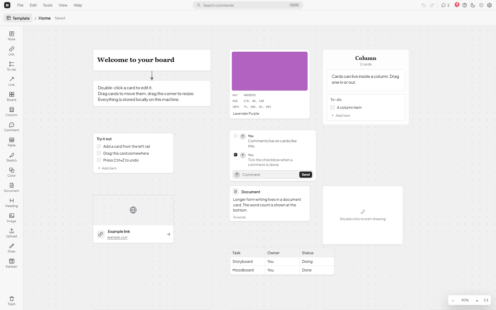
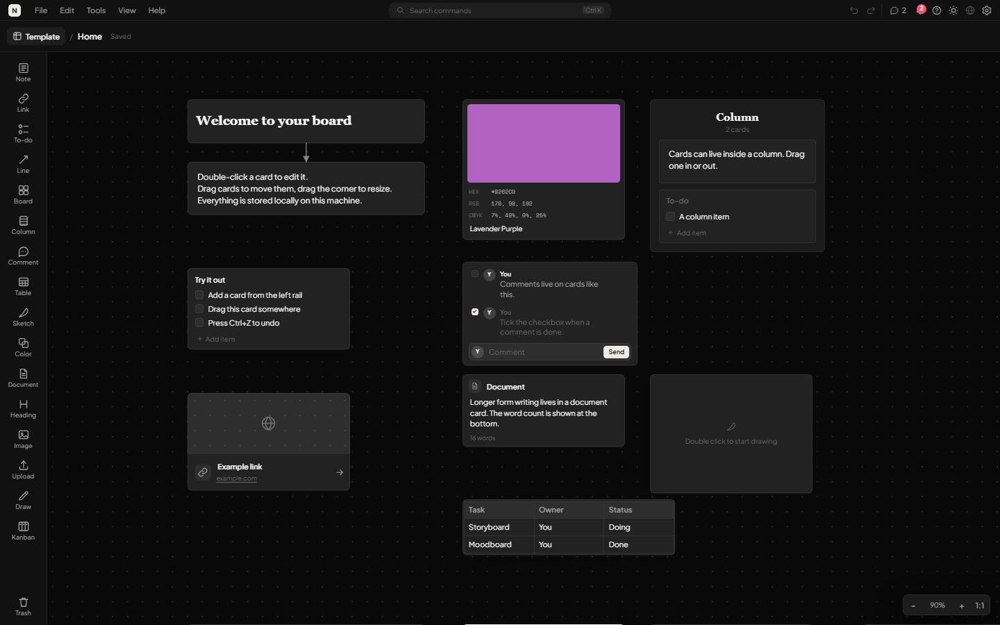
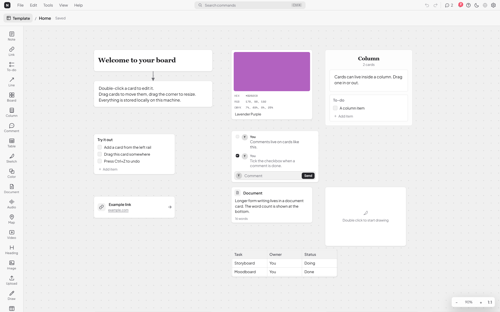
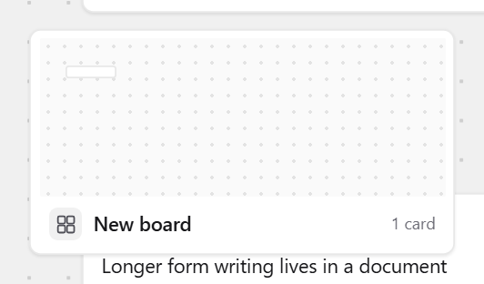
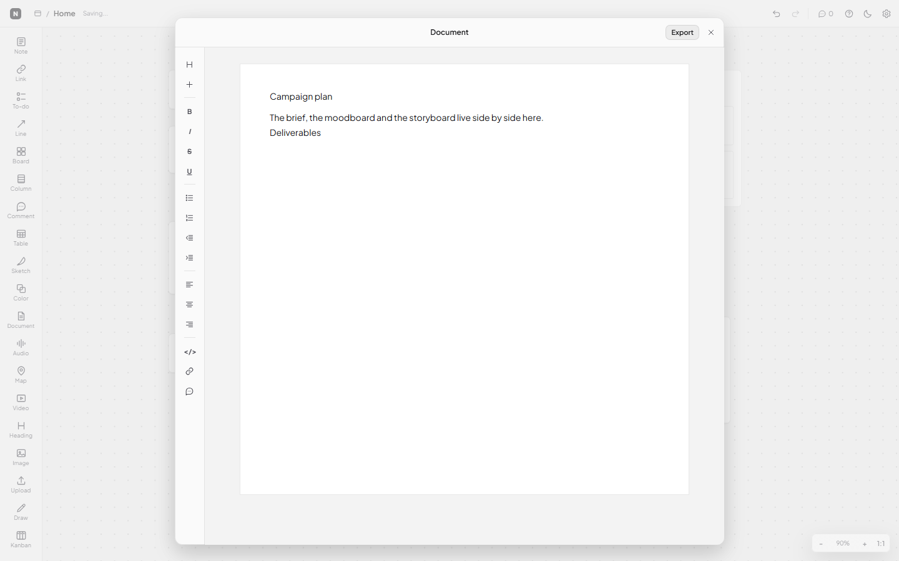
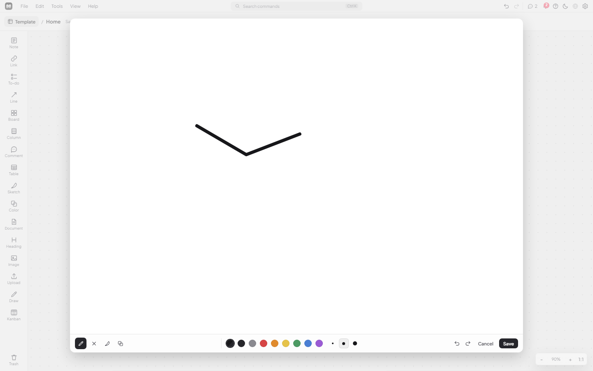
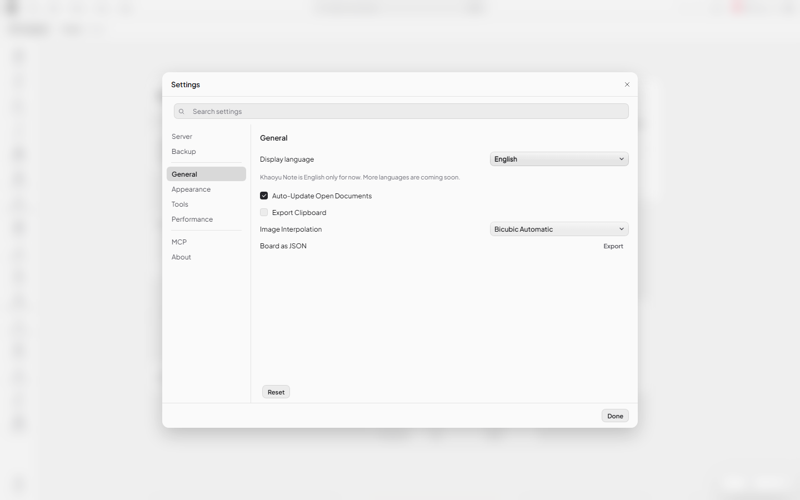
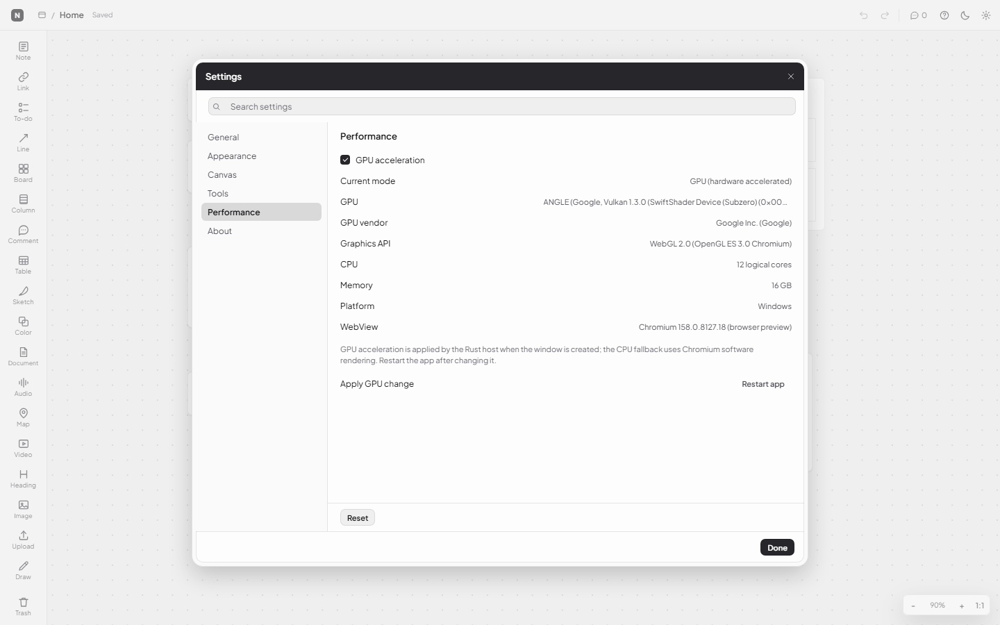

# Khaoyu Note

A local-first desktop app for visual notes, boards, kanban, tables and freehand drawing. Rust backend
(Tauri v2) with a vanilla ES-module frontend. Boards live in a local SQLite database and need no
network. An account is required on first run: the app creates the local database admin, then the
desktop and browser editions both require sign in so board and account activity can be attributed.
Sessions persist on the device and in the browser.





Creating the welcome board seeds one example of every card type, two connection arrows, a kanban with sample cards, a sketch with sample strokes and a nested board card:



Nested board cards carry a mini thumbnail of the board content:



Drag feedback gives an insertion line, a target ghost and a live dragged card.

Document page editor and drawing page editor:





Status: working MVP. Every behavior below is covered by an automated Playwright suite (263 checks
defined in `tools/test-ui.mjs`) and the MCP server has its own smoke suite (17 checks). Both run in
CI. The menu bar sits above the file header, its Share control manages per-board access, right-clicking
a card offers Share link, and **Help > Documentation** opens the offline guide.

## What is here

```
khaoyu-note/
  README.md                  this file
  package.json               localhost web host scripts
  server.mjs                 Node web host: static UI plus SQLite JSON bridge
  service/                   self-hosted service: accounts, sharing, sync, admin (Milestones 1 to 5)
  app/                       the Tauri v2 application
    src-tauri/               Rust backend: SQLite storage, window, bundle config
      src/bin/khaoyu-note-mcp.rs  stdio MCP server binary (14 board tools)
    web/                     frontend (HTML, CSS, ES modules)
      js/                    store, render, interact, ui, home, document-editor, drawing-editor
      vendor/                design-token stylesheet (ky.css, ky.js, unmodified copies)
  docs/
    architecture.md          module map, data flow, storage, design decisions
    security-audit.md        Milestones 1 to 7 security and architecture audit
    threat-model.md          assets, actors, threats, controls and open risks
    incident-response.md     containment, rotation, recovery and communication
    release-checklist.md     verification, security and external release gates
    data-residency.md        storage locations, retention and deletion
    blockers.md              remaining work and external release blockers
    design-system.md         tokens, components, settings structure and service page rules
  scripts/                   static checks, window capture
  tools/                     Playwright preview, UI test suite, screenshots
  shots/                     screenshots used by this README
```

## Design approach

The board is a world plane rendered as DOM, with the CSS `zoom` property for scale and a transform
for pan. Cards are plain
JSON objects in one document, so text editing, selection, accessibility and IME support come from the
browser instead of a custom renderer. Columns keep their children through `parentId` and lay them out
on every structural change. Connections are annotations stored next to the cards, not containers.

Storage is a local SQLite database behind a small Rust bridge. The frontend never opens a socket and
the app works offline; only optional video and map embeds need the internet.

## Feature coverage

| Area | Status |
| --- | --- |
| Infinite canvas, pan, wheel zoom, reset zoom | implemented: max zoom 400 percent, scaled with CSS zoom so text stays sharp |
| Dotted grid, grid toggle | implemented |
| Note card | implemented: plain text and toolbar rich text (bold, italic, underline, strikethrough, code block, lists) survive leaving edit mode and render in the card |
| Heading card | implemented with the same rich-text persistence as the note card |
| To-do list | implemented (accent checkbox with a check mark, add, remove, and a burger handle beside the remove button to reorder items by pointer drag) |
| Comment card | implemented: inline thread list that refreshes and grows automatically, each message shows its upload time as HH:MM and date as DD/MM/YYYY, per-comment done checkbox (no strikethrough) and a three-dot menu with Delete comment, plus a comments popup from the top bar |
| Comments popup | implemented: aggregates every comment in the board and all nested boards, shows board path and time, click jumps to the card |
| Freehand drawing | implemented: pen creates a vector `drawing` card from the pointer path, eraser removes strokes, Move selects and drags them; strokes cannot be reshaped, only selected, moved or deleted, and every stroke uses the same 3 px width by default |
| Contextual toolbar | implemented: editing or selecting a note/heading shows Bold, Italic, Underline, Strikethrough, Code block, bullet and numbered lists; the Draw tool or a selected drawing shows Move, Pen and Eraser |
| Notifications | implemented: comment activity becomes an unread notification, mark one read or unread, mark all as read, remove one, delete all; state persists through app settings and clicking a notification jumps to its comment card |
| Link card | implemented: url, title, clickable domain, open button that launches the URL in the default browser; entering a url fills the title and hides the duplicate domain line; a hero image is fetched from the page metadata, and YouTube links resolve to their thumbnail directly instead of scraping the watch page; right-click Add header image shows the file at its natural ratio above the link row |
| Document card | implemented, opens a full page markdown style editor with toolbar and export |
| Table card | implemented (text cells, editable; the sheet scrolls inside its card with visible thin scrollbars that can be dragged and wheel-scrolled, the A/B/C header strip is clipped to the card and follows horizontal scroll, row numbers follow vertical scroll, the divider between column headers resizes one column, and the plus outside the top-left opens Add row / Add column) |
| Sketch card | implemented, opens a full page drawing editor (pen, pencil, highlighter, eraser, undo, per-tool colour and size options) |
| Color swatch card | implemented (custom HSV picker that opens to the left of the card with saturation/value square, vertical hue slider and hex field, no title and no OK/Cancel buttons because every change applies live, automatic color name from the Coolors name library with nearest-match fallback, HEX/RGB/CMYK stacked vertically with a hover copy button for each code, editable name) |
| Image card | implemented (local file, caption) |
| File card | implemented (local asset; inset hover row, direct download button on hover, click opens the file with the system default app, right-click Download asset copies it to the Downloads folder) |
| Upload tool | implemented and now the single entry point for local media: an image becomes an image card, an audio file an audio card, a video file a video card and any other file a file card. While the audio or video card type is temporarily disabled, those files become file cards instead so the asset stays stored and visible. |
| Audio / video / map cards | temporarily disabled: their cards are hidden from boards, columns, previews and templates, and the stored data is kept so it returns when the feature is re-enabled. Local audio and video files uploaded through the Upload tool are stored as file cards while those types are disabled. Their existing embed code is not removed. |
| Column container + nesting | implemented: drag cards in and out, wrap a multi-selection into a column, child cards hide their resize grip because the column controls their width, collapse/expand toggle with card summary and symmetric top and bottom spacing, drop line, target ghost and settle animation; right-click Convert to board moves the column items into a nested board and replaces the column with a board card |
| Lock position | implemented: right-click Lock position keeps a card selectable and unlockable while blocking drag, resize, inline editing, column and sheet handles; the card shows a lock badge |
| Card conversions | implemented: right-click a note to Convert to document with its text preserved, or a column to Convert to board with its items moved into the new board |
| Kanban board | implemented: auto width from the column count, 500 px minimum height (also inside a column), add/remove columns and cards, inline titles, pointer-drag cards to reorder inside a column or move between columns and other kanban boards |
| Connections / lines | implemented: drag a line between cards, columns, boards or canvas points; endpoints snap to items, are draggable to reattach, and the midpoint can be dragged to curve the line; endpoint and midpoint handles appear only after the line is clicked, straight by default, purely a visual annotation that never groups or moves cards |
| Board nesting | implemented, nested boards with breadcrumb navigation and a mini board thumbnail on the card |
| Language | a disabled globe button in the top bar and a Display language row in Settings > General that lists planned languages and a disabled Coming soon action; all UI copy is English |
| Design system states | audited: buttons use hover, focus, active and disabled states; inputs use the Khaoyu focus glow; menubar, header search and palette have complete keyboard states; remaining gaps are documented in docs/design-system-audit.md |
| Single-file header | implemented: multi-project Home gallery is disabled for now; the app opens one active file, the menu-bar logo and Template button open a template library, and the breadcrumb shows only the current file path |
| Menu bar and command palette | implemented: the fixed menu bar has three columns (logo and menus, centered Search commands, icon actions), grouped command menus, and the command palette with Recently used, Tools, File, Edit, View and Help groups plus arrow keys, Enter and Escape |
| Data safety | implemented: Settings > Backup creates a consistent SQLite snapshot plus assets under Documents/Khaoyu Note Backups and can export it as one ZIP; automatic backups can run daily, every 3, 7 or 14 days, or monthly (30 days) while the app is open, and a missed interval is caught up on the next launch; integrity check runs PRAGMA integrity_check; the restore command validates and stages a backup for the next launch (there is no Restore control in the Backup pane yet); the schema version is checked on open |
| Security hardening | implemented: Tauri CSP is enabled, uploads and native drops are capped at 100 MB, executable and script extensions are blocked, and asset filenames are validated |
| Local accounts (M1) | implemented: first-run setup creates the local admin in the same SQLite database, with PBKDF2-SHA256 password hashes, hashed sessions, and required sign-in on both the desktop and the browser edition. Sessions persist for 30 days on the web host and stay saved on the desktop. The avatar after Share opens a Documentation-style account center with Admin Dashboard, Account Information, Account Settings, History Activity and Log Out. Boards and cards store their creator and last editor, and History records account and board actions. Role enforcement and the full Admin Panel follow in M2 and M3. |
| Card height | implemented: width only resize, auto height for every content card (comment, todo, table, board, document and the rest) with the reference 70 px minimum; fixed-height types are image, video, sketch, map, color, column and kanban |
| Settings | implemented: token-based styling with only the essentials (Account, Server, Backup, General, Appearance, Tools, Performance, MCP, About), search, GPU acceleration with restart plus detected GPU/CPU details, Reset and Done. Account is a profile page with picture, names, email and password; Server holds the runtime details and self-hosted service connection. |
| Tool rail | implemented: order persists in settings, tools can be hidden, tooltip slides in with a key-cap shortcut, single-key tool shortcuts; Map, Video and Audio are temporarily disabled, so they are hidden from the rail and their cards are hidden from boards and templates. Hiding a tool in Settings only removes the rail button and leaves the feature available. |
| Tool drag to canvas | implemented: floating label plus dashed drop preview, card created at the pointer, works reliably in WebView2 because it does not depend on HTML5 drag (board/document/image keep their own flows) |
| MCP server | implemented: `khaoyu-note-mcp.exe` with 14 board tools over the same SQLite database |
| Update check | implemented: the app reads the latest GitHub release of `dezuhan/khaoyu-note` at startup and then once per hour, and from Help > Check for updates or Settings > About. It compares versions, shows the release notes and opens the release page in the browser; it never downloads or runs an installer. A check needs published GitHub Releases, and the request reveals the user IP to GitHub. |
| Card layout | implemented: note/link/document content sits centred, the grip is bottom-right and resizes width only |
| Undo / redo | implemented (snapshot history) |
| Context menu | implemented: grouped Khaoyu menu with shortcuts, disabled states, New note/link/to-do/line/heading/board/column/comment/table/image/file at the click point, wrap multi-selection in a column, archive and move-to-trash/restore, and Rename on projects |
| Autosave | saves 5 seconds after the last change; flushes on board switch, window blur, tab hide and close |
| Delete / trash | implemented: deleting cards moves them to a per-board Trash panel with Restore and Delete, plus Empty trash with confirmation; Cut removes without trashing |
| Multi-select, marquee, drag, resize | implemented |
| Keyboard shortcuts | implemented for canvas and cards |
| Export | partial: JSON board file, plus HTML and Markdown from the document editor |
| Search | command palette searches commands; searching card content is available through the MCP server only |
| System file drop | implemented: native drag and drop stores dropped files as assets, images open as image cards, audio and video use their media cards, raw files and all other documents become file cards; a drop overlay appears while dragging |
| Template library | implemented: Blank board, Welcome board, Project plan, Kanban board, Meeting notes and Moodboard starters replace the active file and can be undone; applying one to a non-empty board asks for overwrite confirmation first |
| Labels and reactions | out of scope for this local app |
| Sharing and sync | optional: they need the self-hosted service in `service/` and are off by default |
| Roadmap | [ROADMAP.md](ROADMAP.md): self-hosted service, login and sharing architecture (planning only) |

### Settings, GPU and comments

Settings dialog:



GPU acceleration lives under **Performance**. The value is stored in SQLite and read before the window
is created, so turning it off restarts the webview with `--disable-gpu --disable-gpu-compositing` on
the next launch. "Restart app" applies it immediately.



The top bar comment icon opens a popup with every comment from the current board and its nested
boards, including the board path. Clicking an item opens that board and centres the comment card.

Link cards after first entry: the url fills the title and the duplicate domain line is hidden; the
empty state keeps a single Link URL field.

Dragging a tool out of the rail shows a floating label plus a dashed preview of the card size at the
pointer; dropping creates the card right there. Dropping on a rail button still reorders the rail.

Table cards reveal a small plus button on hover. Clicking it opens a menu with "Add row" and
"Add column", so the sheet grows without leaving the canvas.

## Applications

Run it:

```powershell
cd app
npm install
$env:CARGO_TARGET_DIR='C:\temp\mn-target'
cmd /c "call `"C:\Program Files\Microsoft Visual Studio\2022\Community\VC\Auxiliary\Build\vcvars64.bat`" && npx tauri dev"
```

Build installers:

```powershell
cd app
$env:CARGO_TARGET_DIR='C:\temp\mn-target'
cmd /c "call `"C:\Program Files\Microsoft Visual Studio\2022\Community\VC\Auxiliary\Build\vcvars64.bat`" && npx tauri build"
```

Prerequisites: Rust stable with the MSVC host triple, Visual Studio 2022 C++ build tools, WebView2
runtime, Node 20+.

Two machine-specific notes:

1. The project lives under `Documents`, and WebView2 window creation fails there with "Access is
   denied (os error 5)". The sources stay in place; only the build directory is redirected outside
   the protected folder with `CARGO_TARGET_DIR`.
2. SQLite is compiled from source (`rusqlite` with the `bundled` feature), so the build must see the
   MSVC environment (`cl.exe`, `INCLUDE`, `LIB`). Running cargo or `tauri build` through `vcvars64.bat`
   as shown above takes care of that.

Data lives in `%APPDATA%\com.dezuhan.khaoyunote\`:

- `khaoyu-note.db`, a SQLite database with `boards`, `cards`, `connections`, `assets` and `meta` tables
  (WAL mode). Data from earlier app identifiers is migrated into this folder automatically on first
  launch; legacy JSON boards are imported and the old folder is renamed to
  `boards-json-backup-<timestamp>`.
- `assets\<uuid>-<name>`, uploaded images and files (served to the webview through the asset
  protocol, scoped to the app data directory)

## Web mode (localhost)

```powershell
npm run web
```

Then open `http://127.0.0.1:1430`. The host serves the same frontend and uses the same SQLite
database and asset folder as the desktop app, so a board edited in the browser is visible in the app.
No browser install is needed beyond Node 24 or newer because the host uses the built-in `node:sqlite`
module. Run `npm install` once so the backup archive can use `fflate`.

- `KHAOYU_WEB_HOST` changes the bind address, default `127.0.0.1`.
- `KHAOYU_WEB_PORT` changes the port, default `1430`.
- `KHAOYU_NOTE_DB_DIR` points at another data folder, useful for a separate demo database.
- `http://127.0.0.1:1430/status` returns host, port, database path, uptime, version and Node version.
- The menu bar shows a `host:port` badge, and Settings > About repeats the host, port and URL.

Browser limitations: dropping a local file path from the OS is not available (upload through the file
picker instead), and folder restore plus the stdio MCP server remain desktop-only.

## Self-hosted service foundation and accounts (Milestones 1 and 2)

The `service/` directory contains the self-hosted service: one Node 24 HTTP process, a relational
SQLite schema for accounts, sessions, projects, memberships, snapshots and audit rows, opaque object
storage, a maintenance worker, reversible migrations, backup and restore, and a minimal health
endpoint. The account core includes Argon2id passwords, rotating refresh tokens
with reuse detection, session management, password reset, TOTP, email one-time codes, WebAuthn
passkeys, account deletion grace, project role checks and scoped API tokens. Project assets have
authenticated upload, member-only download and share download enforcement.

```powershell
cd service
Copy-Item .env.example .env
# Set KHAOYU_SERVICE_SECRET to: openssl rand -hex 32
$env:KHAOYU_SERVICE_PUBLIC_URL = "http://127.0.0.1:8080"
$env:KHAOYU_SERVICE_COOKIE_SECURE = "false"
$env:KHAOYU_BOOTSTRAP_PASSWORD = "use-a-unique-password-of-12-plus"
node src/cli.mjs migrate
node src/cli.mjs bootstrap
node src/server.mjs
```

`GET /healthz` returns only `{"status":"ok"}`. Docker Compose, reverse proxy examples, auth endpoints,
sharing endpoints, configuration, backup and upgrade steps are documented in
[service/README.md](<service/README.md>). The current security findings and remaining risks are in
[docs/security-audit.md](<docs/security-audit.md>), [docs/threat-model.md](<docs/threat-model.md>),
[docs/incident-response.md](<docs/incident-response.md>), and
[docs/release-checklist.md](<docs/release-checklist.md>). Vulnerability reports follow
[SECURITY.md](<SECURITY.md>).

The service exposes project, item and column share links, passphrase and expiry controls, member
roles, invitations and ownership transfer. The service account page is at `/account`, passkey
management is at `/passkeys`, sharing is at `/shares`, and a shared link opens read-only at
`/s/:token`. Desktop boards can opt in to server sync from the Sync control in the topbar: open it,
enter the service URL and your account email and password, then choose Sign in and connect. A local
service needs no domain: `127.0.0.1:8080`, `localhost:8080` and `http://localhost:8080` are all
accepted, while a remote host defaults to `https`. The dialog calls `/readyz` (service and database),
signs in, and receives a scoped project token that the client stores without showing it; the Account
pane repeats Server, Account and Status. A new account is created on the service at `/account`, which
the dialog links to. The local board
remains authoritative until the connection is confirmed. Verification is disabled: registration creates a usable account
immediately, and the verify UI is hidden. Reset mail uses SMTP when configured and
otherwise the outbox. The service tests run with:

```powershell
node --test service/test/service.test.mjs service/test/auth.test.mjs
node tools/test-sync.mjs
```

Create a sync token after the service is running:

```powershell
$env:KHAOYU_SERVICE_PASSWORD = "your-account-password"
node tools/create-service-token.mjs --base http://127.0.0.1:8080 --email you@example.com
```

## MCP server

A second binary, `khaoyu-note-mcp.exe`, exposes the boards to AI agents through the Model Context
Protocol over stdio. It opens the same SQLite database as the app (WAL mode, so both can run at the
same time) and never talks to any network service.

Tools: `list_boards`, `get_board`, `get_board_json`, `get_card`, `search`, `list_comments`,
`create_board`, `update_board`, `delete_board`, `create_card`, `update_card`, `delete_card`,
`add_comment`, `connect_cards`.

Build it (same toolchain setup as the app):

```powershell
cd app\src-tauri
$env:CARGO_TARGET_DIR='C:\temp\mn-target'
cmd /c "call `"C:\Program Files\Microsoft Visual Studio\2022\Community\VC\Auxiliary\Build\vcvars64.bat`" && cargo build --release --bin khaoyu-note-mcp"
```

The binary lands in `C:\temp\mn-target\release\khaoyu-note-mcp.exe` and is also copied to `dist/`. The
NSIS and MSI installers currently ship only the app executable, so copy `khaoyu-note-mcp.exe` beside
it (or to a stable folder such as `%LOCALAPPDATA%\Khaoyu Note\`) and point clients there. Bundling it
as a Tauri sidecar is still open; see `docs/packaging.md`.

### DeepSeek Harness

This repo ships a configuration-only bundle in `dsh-bundle-note-studio-mcp/`; installing it with the
Harness plugin manager adds the server to the current profile as `@local/note-studio-mcp`. Its patch:

```yaml
- insert:
    - id: mcp-khaoyu-note
      name: '@deepseek-ai/dsh-mcp-client'
      config:
        serverName: khaoyu-note
        transport: stdio
        command: 'C:\Users\dezuhan\AppData\Local\Khaoyu Note\khaoyu-note-mcp.exe'
        failOnStartupError: true
```

Restart DeepSeek Harness after installing; the tools then appear as `mcp__khaoyu-note__<tool>`. The
Settings > MCP pane shows the same JSON (built from the resolved binary path) with a Copy JSON button.

### Other MCP clients

Register it in any MCP client (example for a JSON config):

```json
{
  "mcpServers": {
    "khaoyu-note": {
      "command": "C:/path/to/khaoyu-note-mcp.exe"
    }
  }
}
```

The database directory defaults to `%APPDATA%\com.dezuhan.khaoyunote`; set `KHAOYU_NOTE_DB_DIR`
to point the server at a different folder (portable setups, or isolated test runs).

Settings > MCP shows the resolved server binary path, the transport, the database folder and the 14
tools, plus a copyable client configuration JSON.

## Tests and tooling

```powershell
# static check: JS syntax, import/export resolution
node --experimental-vm-modules scripts/check-web.cjs

# UI suite. Either start `npx tauri dev` (it serves 127.0.0.1:1430), or serve the
# frontend directly when you only need browser preview:
node tools/serve.mjs 1430
cd tools
node test-ui.mjs

# fresh screenshots of the web UI
node tools/shots.mjs

# save-conflict dialog (load newer version / keep a copy)
node tools/test-save-conflict.mjs

# failed save keeps the board dirty and retries automatically
node tools/test-save-retry.mjs

# boot and delete never reopen a trashed board
node tools/test-board-selection.mjs

# breadcrumb rename uses an explicit Save button
node tools/test-rename.mjs

# a renamed nested board updates its parent board card
node tools/test-board-card-title.mjs

# column children keep their slots after returning from a nested board
node tools/test-column-layout.mjs

# column title is editable in place
node tools/test-column-title.mjs

# kanban scrollbar inside a column is draggable
node tools/test-kanban-scroll.mjs

# a tool dropped on a column becomes its child
node tools/test-tool-drop-column.mjs

# Wrap in column only applies to non-column items
node tools/test-wrap-selection.mjs

# code block icon and design-system tooltips
node tools/test-tooltips.mjs

# line snap distance and connection hit area
node tools/test-line-area.mjs

# lock position, conversions, and sheet scrolling in a column
node tools/test-card-features.mjs

# variable fonts still serve distinct weights
node tools/test-fonts.mjs

# MCP server smoke test (spawns the binary against a temporary database)
node tools/test-mcp.mjs

# update check version comparison, release parsing and error handling
node tools/test-update.mjs

# automatic backup interval and catch-up rules
node tools/test-auto-backup.mjs

# temporarily disabled card types stay out of boards and templates
node tools/test-disabled-cards.mjs

# local accounts on the web host (schema, setup, sessions, CSRF, history)
node tools/test-auth-web.mjs

# self-hosted service and account tests (Node 24, temp databases)
node --test service/test/service.test.mjs service/test/auth.test.mjs

# live security smoke check against a running service
node tools/check-service-security.mjs --base http://127.0.0.1:8080 --credentials target/service-dev-credentials.json

# screenshot of the native window
powershell -NoProfile -ExecutionPolicy Bypass -File scripts/screenshot.ps1

# localhost web host against the same SQLite database
node server.mjs
node tools/test-web-mode.mjs
```

`.github/workflows/ci.yml` runs the web suites on Ubuntu, the service foundation tests and Docker
build on Ubuntu, and the Rust plus MCP gates on Windows for every push, pull request and manual
dispatch. The separate `desktop-release.yml` stays tag-only.

The UI suite exercises: boot, tool rail, card creation, text editing, drag, resize, undo/redo,
to-do items, comments, table cells, column drop, zoom, settings modal and custom select, theme
switching, the disabled Home state, nested board breadcrumbs, document editor, drawing editor, context
menu, and persistence (263 checks). The MCP suite spawns `khaoyu-note-mcp.exe` against a temporary database and
checks the JSON-RPC handshake, tool listing, board/card creation, updates, comments, search, nested
boards, connections and tree deletion (17 checks).

Built artifacts are copied to `dist/`. The files below are the last built release (0.33.0):

| File | Size | Purpose |
| --- | --- | --- |
| `Khaoyu Note_0.33.0_x64-setup.exe` | 4.17 MiB | NSIS installer (app and MCP binary) |
| `Khaoyu Note_0.33.0_x64_en-US.msi` | 6.77 MiB | MSI installer (app and MCP binary) |
| `KhaoyuNote.exe` | 13.86 MiB | standalone executable (SQLite bundled, GPU flag aware) |
| `khaoyu-note-mcp.exe` | 2.71 MiB | standalone MCP server for AI agents |

Rebuild them with `npx tauri build` (with `CARGO_TARGET_DIR` set as above).

## Design tokens

The app chrome uses a vendored token stylesheet (`vendor/ky.css`, `vendor/ky.js`, unmodified
copies). That means 24 px controls, 7 px control radius, 12 px floating radius, 12/17 body text,
custom select dropdowns, and four host skins (`light`, `softLight`, `softDark`, `dark`) driven by
`--ph-*` tokens.

Colour is always a `--ky-*` / `--ph-*` token or a `var()` fallback. One intentional content-level
exception: the Heading card and column titles use a serif stack (Georgia, Times), because editorial
serif headings separate board titles from body text. UI chrome, controls and card body text stay on
the shared token scale.

Typography uses three swappable families: Plus Jakarta Sans for body text, Space Mono for code and
numeric codes (colour HEX/RGB/CMYK, sizes), and Georgia as the default editorial serif for headings.
The Google Fonts woff2 files are vendored in `app/web/fonts` (no runtime network needed) and declared
in `css/fonts.css`. DM Sans, Playfair Display and Plus Jakarta Sans are variable fonts, so each family
ships one file with a `font-weight` range; Space Mono keeps its two static weights. Settings >
Appearance exposes Heading font, Body font and Code font selects; each one can be switched between the
bundled Google families (Plus Jakarta Sans, DM Sans, Playfair Display, Space Mono) and, for headings,
the system Georgia serif.

## Roadmap

This list is the product backlog for the local app. `ROADMAP.md` is the separate plan for the
self-hosted service, accounts, sharing and the planned AI assistant.

1. Export to Markdown and PDF.
2. Board search and richer trash filters.
3. Better line tool (endpoint styles, labels, dashed/dotted) and connection handles.
4. Table cell types (number, date, checkbox) and column widths.
5. Image variants: thumbnails for large uploads, crop/background modes.
6. Optional sync layer for importing or mirroring boards from other tools.
7. Optional WebGPU/WebGL rendering path if boards grow past DOM performance limits.

## Legal note

This is an independent local-first app for personal use. No third-party client code, assets, fonts or
icons are included. The vendored token stylesheet is reused under its own repository license.


