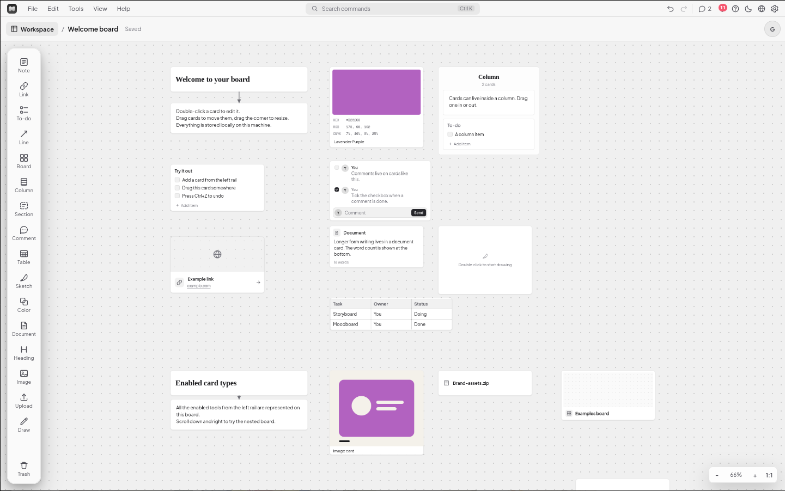

# Khaoyu Note

A local-first visual workspace for thinking, planning and writing. Khaoyu Note runs as a native
desktop app or a local browser host, stores every board in SQLite, and works without an account or
network. A self-hosted collaboration service is under development in `service/`; it is experimental
and not part of this release.

> **0.36.2 local-first release:** backend controls stay disabled in the app. Sync, Share, Add Server
> and the remote workspace sections are hidden; Local storage supports multiple boards, with **New
> Board** in the Workspace popover. The self-hosted service in `service/` is experimental and not part
> of this build, and backend connection files are gitignored.

## Downloads

Version 0.36.2 local-first builds:

- Windows: `Khaoyu Note_0.36.2_x64-setup.exe` (NSIS) or `Khaoyu Note_0.36.2_x64_en-US.msi`
- Linux: `Khaoyu.Note_0.36.2_amd64.deb`, `Khaoyu.Note_0.36.2_amd64.AppImage` or
  `Khaoyu.Note-0.36.2-1.x86_64.rpm`
- macOS: `Khaoyu.Note_0.36.2_universal.dmg`



## About

Khaoyu Note is built around an infinite canvas with plain, editable cards. A board is a single JSON
document, so text editing, selection, accessibility and IME support come from the browser instead of a
custom renderer. Nested boards keep large projects readable, and the same document can be edited in the
desktop app or the local web host.

The project is split into two parts:

- **Local app** — Tauri v2 + Rust, with a vanilla ES-module frontend and a local SQLite database.
- **Service** — an optional self-hosted Node 24 service for accounts, workspaces, sync, share links
  and an admin dashboard.

Local use is always the default. Connecting a server is opt-in per board.

## Core features

- **Infinite canvas** — pan, zoom, dotted grid, marquee selection and keyboard-first editing.
- **Cards for real work** — note, link, to-do, table, document, sketch, image, video and audio.
- **Boards and columns** — nested boards with live thumbnails, columns, sections and connections.
- **Local-first storage** — SQLite database and local assets; boards open offline.
- **Desktop and browser** — the same frontend and database in Tauri or through `node server.mjs`.
- **Optional collaboration** — self-hosted accounts, workspaces, roles, OIDC/2FA/passkeys, durable
  sync, comments and public share links with expiry, passwords and download limits.
- **MCP server** — 14 board tools over stdio for local AI agents, using the same SQLite database.

## Self-hosted service (experimental)

The collaboration service in `service/` is under active development and **not part of this build's
supported surface**. The desktop app, local web host and MCP server work without it, and this release
does not require Docker, PostgreSQL, Redis, a public URL or a service account. Developers who want to
try the experimental service should read [service/README.md](service/README.md); its account, sync and
sharing flows are not released or production ready yet.

## MCP server

`khaoyu-note-mcp` exposes local boards to MCP clients over stdio. It opens the same SQLite database as
the app in WAL mode (both can run together) and makes no outbound network requests.

Tools: `list_boards`, `get_board`, `get_board_json`, `get_card`, `search`, `list_comments`,
`create_board`, `update_board`, `delete_board`, `create_card`, `update_card`, `delete_card`,
`add_comment` and `connect_cards`.

Build it from the app source:

```bash
cd app/src-tauri
cargo build --release --bin khaoyu-note-mcp
# Linux binary: target/release/khaoyu-note-mcp
# Windows binary: target/release/khaoyu-note-mcp.exe
```

Put the binary somewhere stable, then register it with any MCP client:

```json
{
  "mcpServers": {
    "khaoyu-note": {
      "command": "/absolute/path/to/khaoyu-note-mcp"
    }
  }
}
```

The repository includes a configuration-only bundle in `dsh-bundle-note-studio-mcp/` for DeepSeek
Harness; after installing it, the tools appear as `mcp__khaoyu-note__<tool>`. Settings > MCP in the
app shows the resolved binary path and a copyable client configuration.

The database directory matches the app's app-data folder:
`%APPDATA%\com.dezuhan.khaoyunote` on Windows,
`$XDG_DATA_HOME/com.dezuhan.khaoyunote` (usually `~/.local/share/com.dezuhan.khaoyunote`) on Linux,
and `~/Library/Application Support/com.dezuhan.khaoyunote` on macOS. Set `KHAOYU_NOTE_DB_DIR` to use
another folder.

## License

Khaoyu Note is open source under the
[GNU Affero General Public License v3.0 only](LICENSE) (`AGPL-3.0-only`).

- You may use, study, modify, self-host, distribute and commercialize the software.
- If you distribute a modified version, or run a modified version as a network service, you must
  publish the complete corresponding source under the AGPL and keep the copyright and license notices.
- Forks must give attribution to Khaoyu Note.
- The Khaoyu Note name, logo and app icon are not licensed for modified distributions; see
  [TRADEMARK.md](TRADEMARK.md).
- Resale is only allowed under AGPL terms with the source available. A fork may not be presented as
  the official Khaoyu Note app.

This is an independent local-first app. No third-party client code, assets, fonts or icons are
included; vendored design tokens remain under their own repository license.
